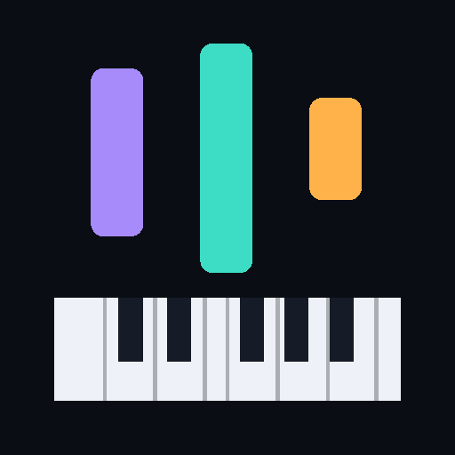

# Cascada — piano en tu iPad

Un tutor de piano con las notas cayendo sobre el teclado. Vive entero en el navegador:
sin cuenta, sin suscripción, sin límite de canciones y sin internet una vez instalado.

Hecho con el pack de skills [replica-skill](https://github.com/Jakeschincariol/replica-skill),
a partir del mapa de funciones de una app de App Store. Clean room: se replicaron las
funciones y el recorrido, no su código, su catálogo, sus textos ni su marca.
El trabajo de reconocimiento está en [`replica/`](replica/).



---

## Ponerlo en el iPad (3 minutos)

### 1. Publica la página

El repositorio ya trae el flujo de GitHub Pages. Solo hay que encenderlo:

1. En GitHub, ve a **Settings → Pages**.
2. En **Source**, elige **GitHub Actions**.
3. Listo. **Todo lo que llega a `main` se publica solo**: el flujo corre las tres suites y,
   solo si pasan, despliega. Si algo falla, la versión viva se queda como estaba.

Queda en `https://javi-molin.github.io/piano/`.

> Hace falta `https`. Instalarla y el modo sin conexión dependen de un service worker, y
> eso no funciona abriendo el archivo a pelo.

### 2. Instálala

En el **iPad, con Safari** (no con Chrome: en iOS solo Safari sabe instalar):

1. Abre la dirección de arriba.
2. Toca **Compartir** (el cuadrado con la flecha).
3. **Añadir a pantalla de inicio** → **Añadir**.

Ya tienes el icono. Ábrelo desde ahí: va a pantalla completa, sin barras, y funciona en avión.

### 3. Primer uso

Elige si quieres los nombres de nota en **Do Re Mi** o en **C D E**, y empieza. El catálogo
trae 14 piezas; la primera recomendada es la escala de Do mayor o *Estrellita*.

---

## Cómo se usa

| | |
| --- | --- |
| **Aprender** | La canción **te espera** en cada nota, el tiempo que necesites. Si te adelantas, va contigo: el tempo lo pones tú. Es el modo para empezar. |
| **Tocar** | A tiempo, con la precisión contada pero sin presión. |
| **Dominar** | Con puntaje, estrellas y tres niveles de exigencia. Una pieza queda "dominada" con 90 % a velocidad real. |
| **Escuchar** | Solo oírla, viendo caer las notas. Para enterarte de cómo va antes de tocarla. |

Dentro del reproductor: **velocidad** del 25 al 200 % en vivo, **manos** (la que no practicas
la toca la app), **bucle**, **metrónomo**. Al terminar, un mapa de calor te dice en qué
compases se te escapa, y un botón te mete a practicar justo esos.

### Con qué puedes tocar

- **La pantalla.** Multitouch, con los nombres de nota sobre las teclas.
- **Tu piano de verdad**, por el **micrófono**. Ajustes → Con qué toco → Micrófono, y ahí
  mismo ves lo que oye, para comprobarlo sin fiarte. Oye **varias notas a la vez**, que es
  como suena un piano: con pedal, o tocando seguido, las cuerdas anteriores siguen sonando.
  Medido contra un piano simulado realista: **oye las 42 notas de seis escenarios distintos**
  —incluido pedal y sala ruidosa— y se cuela alguna de más, unas trece en total. Con
  auriculares va mejor: si no, el altavoz se oye a sí mismo.
- **Un teclado MIDI**, donde el navegador tenga Web MIDI. **Safari en iPad no lo trae**:
  en el iPad, el camino es la pantalla o el micrófono.
- **El teclado del ordenador**: fila `Z`…`M` y `Q`…`P`.

### Tus canciones

- **Importa cualquier `.mid`**: arrastrándolo, eligiéndolo o pegando el enlace directo.
  Esto es lo que hace que la biblioteca no tenga límite, y es exacto.
- **Pega un enlace de YouTube, Spotify o SoundCloud** y Cascada lee el título y te lleva a
  los dos caminos que sí funcionan (ver abajo).
- **Sube audio** (`.mp3`, `.m4a`, `.wav`, `.ogg`, `.flac`), uno o varios de golpe, **sin
  límite de peso ni de duración**. La transcripción está **en beta** y tiene dos modos:
  **acordes y melodía**, que saca varias notas a la vez, y **solo la melodía**, más rápido
  y más limpio con una sola línea. El tempo lo detecta sola. Lo único que crece con la
  duración es el tiempo: unos 12 segundos de análisis por minuto de audio (el triple en
  modo acordes), con su barra de progreso.
- **Graba** lo que improvises en Juego libre y se guarda como una canción más.
- **Exporta** toda tu biblioteca a un `.json` desde Ajustes. Como no hay nube, esa es la
  forma de llevártela a otro dispositivo o de no perderla si borras los datos de Safari.

### Una canción de YouTube o Spotify

Pégale el enlace en **+ Añadir canción**. Cascada lee el título (con el oEmbed público del
servicio: sin clave y sin cuenta) y te deja en dos caminos:

1. **Buscar un MIDI de esa canción.** Es lo exacto: las notas de verdad, con las dos manos.
   Un toque y estás buscándolo con el título ya puesto.
2. **Ponla y que Cascada la escuche.** Le das a grabar, suena la canción —en un altavoz al
   lado, o compartiendo el sonido de otra pestaña si estás en un portátil— y saca la melodía
   de oído, con el tempo detectado solo.

**Lo que no hace, y por qué:** convertir el enlace solo, de un toque. Spotify no entrega
audio que el navegador pueda leer, y YouTube ni permite descargarlo desde otra página ni lo
autoriza. Y aunque llegara el audio, transcribir una mezcla completa con calidad necesita un
modelo corriendo en un servidor. Aquí no hay servidor: ese es justo el precio de que la app
sea tuya, gratis, sin cuenta y sin conexión. Así que en vez de un botón que falla, están los
dos caminos que llevan a lo mismo en dos toques.

### Tu piano, el que tienes de verdad

En **Ajustes → Tu piano** dices de cuántas teclas es: 25, 37, 49, 61, 76, 88 o sin límite.
Si tu teclado no empieza en un Do, mueve la nota más grave por octavas.

Con eso puesto, lo que no entra en tu teclado se arregla como tú digas:

- **Traerlas a la octava más cercana** (por defecto). Cambia un poco la música —un bajo sube
  una octava y se nota— pero puedes tocar la pieza entera en lo que tienes.
- **Omitirlas.** Se quitan y punto.
- **Mostrarlas igual.** Las ves aunque no las alcances.

El detalle de cada canción te dice en una línea cuántas notas se movieron y cuántas se
quitaron, para que no haya sorpresas.

### Subir o bajar la canción entera

En el detalle de la canción: **− Octava / − Semitono / Original / + Semitono / + Octava**, o
el deslizador para cualquier punto entre −24 y +24 semitonos. La digitación se recalcula
sola y el tono se recuerda para esa canción. Si al subir se te sale del teclado, el ajuste de
tu piano lo recoge después.

### El catálogo

14 piezas de **dominio público**, arregladas aquí: escala de Do y arpegios, Hanon n.º 1,
*Estrellita*, *Oda a la Alegría*, *Jingle Bells*, *Noche de paz*, Minueto en Sol,
estudio de arpegios, *Greensleeves*, *Para Elisa*, Canon en Re, Preludio en Do de Bach y
el tema del *Claro de luna*. No hay nada con derechos: lo demás lo pones tú con tus MIDI.

---

## Para desarrollar

Cero dependencias y cero compilación. Solo hace falta un servidor estático, porque los
módulos ES no cargan desde `file://`.

```bash
python3 -m http.server 8080     # o: npm start
# http://localhost:8080
```

```bash
npm test          # 59 del núcleo + micrófono + tokens + despliegue (solo Node)
npm run test:e2e  # 37 recorridos en Chromium (necesita playwright)
npm run icons     # regenera los iconos desde los tokens
```

### Qué hay dentro

```
index.html             una sola página, pantallas conmutadas
styles.css             tokens de diseño como custom properties
sw.js                  service worker: todo del caché primero
src/score.js           modelo musical: DSL propio, digitación, secciones, tu teclado
src/songs.js           el catálogo de dominio público
src/midi.js            lector y escritor de MIDI estándar, y entrada Web MIDI
src/audio.js           piano sintetizado (sin un solo byte de sample)
src/pitch.js           afinación: YIN en dos pasadas y FFT, compartido
src/mic.js             notas por micrófono, de Mi1 a Do7, una a la vez
src/transcribe.js      audio a notas: melodía o acordes, tempo automático, grabación (beta)
src/keyboard.js        geometría, dibujo y multitouch del teclado
src/roll.js            el piano-roll que cae
src/player.js          el tutor: modo espera, puntuación, bucle
src/store.js           IndexedDB + localStorage, exportar e importar
src/ui.js, src/app.js  pantallas y cableado
tools/make_icons.py    genera los PNG del icono, sin librerías
tests/                 núcleo, micrófono, tokens, despliegue y navegador
                       (con un piano simulado y un mp3 de prueba, los dos propios)
replica/               recon, arquitectura, diseño, marca, pruebas, paridad
.claude/skills/        el pack replica-skill, por si quieres repetir algún paso
```

Decisiones que explican casi todo lo demás:

- **El reloj maestro es el del audio**, no `requestAnimationFrame`. rAF deriva; el audio no.
- **Todo se mide en beats**, no en milisegundos. Así, al bajar la velocidad, el margen de
  acierto se ensancha solo: ralentizar ayuda de verdad.
- **Sin samples de piano.** Un piano grabado son decenas de megas y mataría el modo sin
  conexión. El timbre es sintético y la app entera pesa menos que una foto.
- **Sin backend.** El precio: no hay sincronización entre dispositivos. Se cubre exportando.

---

## Lo que esta app **no** hace

Dicho antes de que lo descubras tú:

- **No convierte una canción de Spotify o YouTube en un tutorial de un toque.** Eso necesita
  un modelo de transcripción corriendo en un servidor, y aquí no hay servidor. Lo que sí
  hace: leer el título del enlace, llevarte a buscar su MIDI —que es exacto— o grabarla
  mientras suena y sacarla de oído.
- **La transcripción propia oye acordes, pero no es un modelo entrenado.** Medida sobre
  acordes de piano simulado con todo lo que lo hace difícil (cuerdas con rigidez, tres por
  nota, sala): encuentra **22 de 24 notas, pero se inventa unas 10**. Sobre tonos sintéticos
  perfectos salía impecable; esa cifra no servía para nada, porque un piano no suena así.
  Para exactitud, importa un MIDI.
- **No tiene catálogo de canciones conocidas.** Serían licencias. El catálogo es de dominio
  público y lo tuyo lo pones tú.
- **No hay cuenta ni nube.** Si borras los datos del navegador sin exportar, se va.
- **No manda recordatorios.** Una PWA en iOS no da notificaciones sin más. La racha está,
  el aviso no.
- **Está solo en español.**

Paridad medida contra el mapa de recon: **90 / 100**
(`npm run parity`). Lo que falta es exactamente lo de arriba.

## Licencia

MIT. Las obras del catálogo son de dominio público; los arreglos se escribieron aquí.
